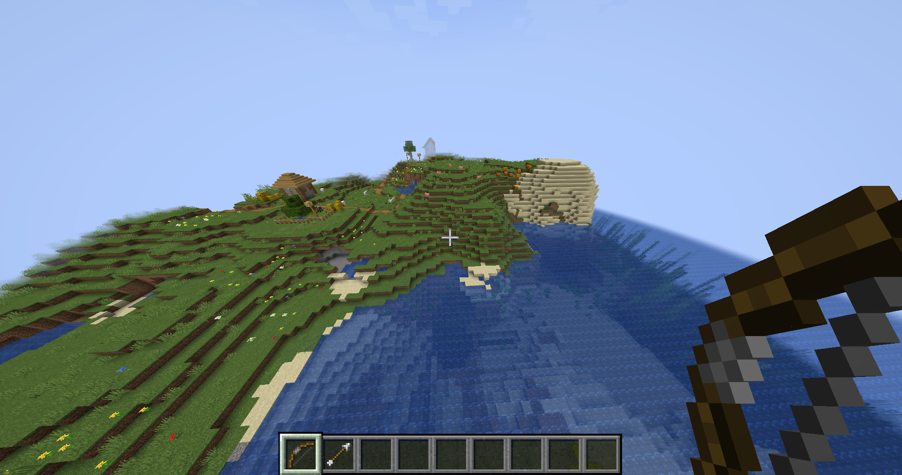
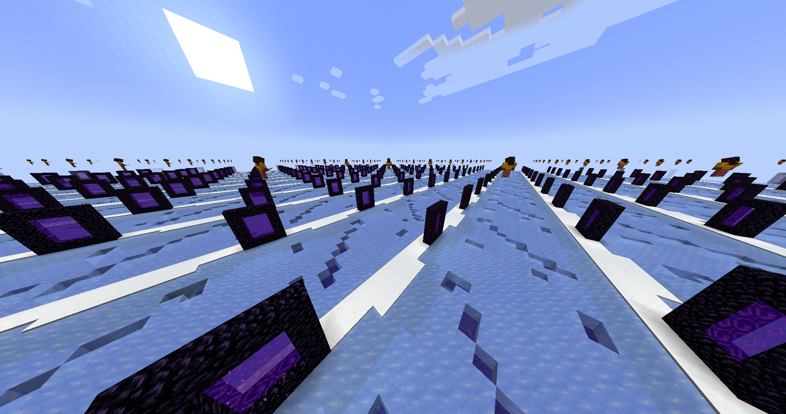
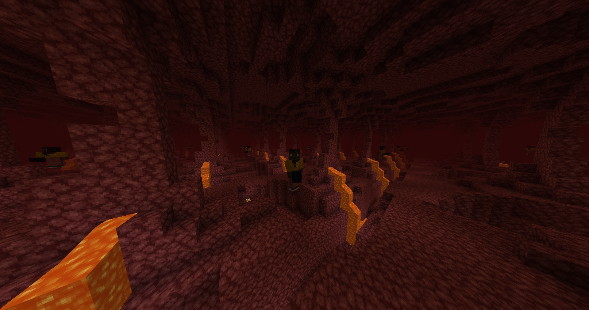
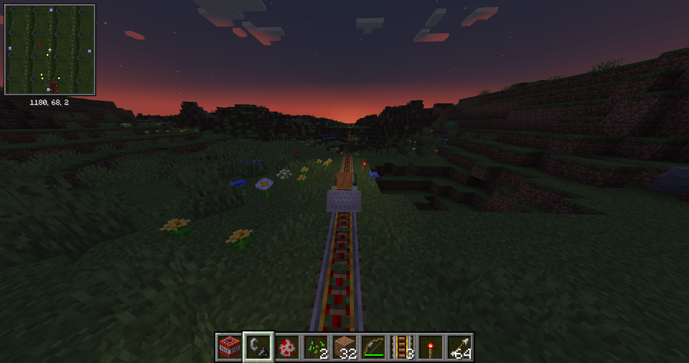
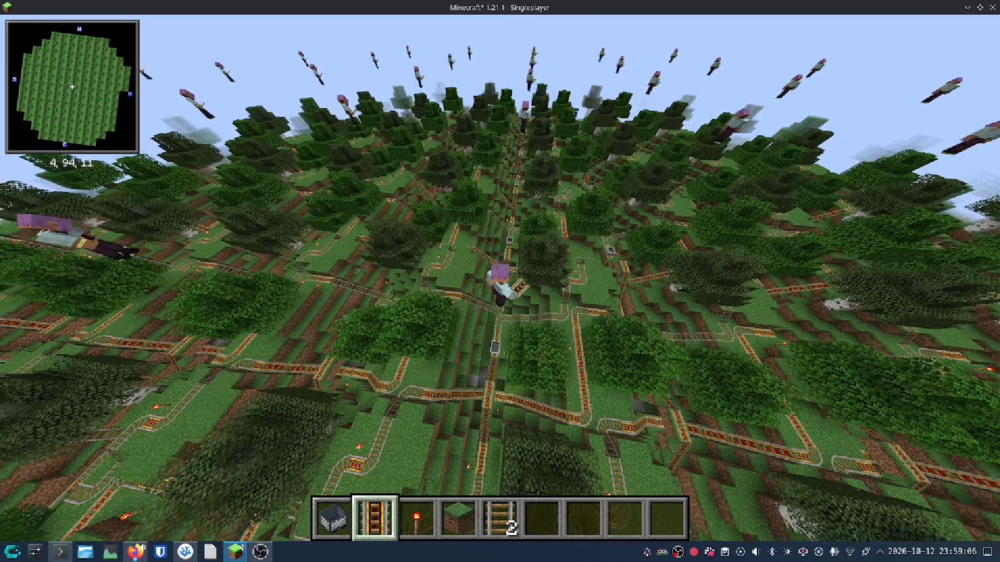
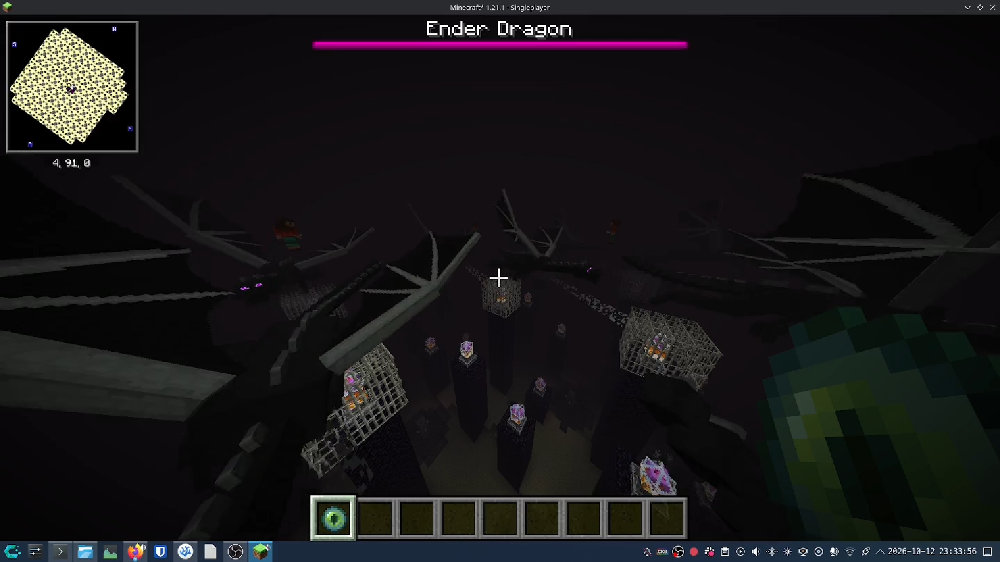

# Seamless World Wrap 🌍

A Minecraft mod that gives a world a fixed size and connects its opposite edges. Walk off the east
edge and you come in from the west. There's no wall, no loading screen and no visible seam.



## Features
- Wrap east-west, north-south, or both.
- World size from 1 x 1 chunk up to 2048 x 2048 chunks.
- The Nether wraps at 1/8 of the Overworld size, so portals still line up.
- The End can match the Overworld, use its own size, or not wrap.
- Terrain is blended at the edges so it continues across them.
- Blocks, redstone, structures, mobs, minecarts and projectiles work across the edges.
- In small worlds you can see repeated copies of the world, yourself and mobs in the distance.
- "Start in a Forest" moves the terrain so the world is centered on dry land with trees.
- Worlds too small for a stronghold or fortress get an End portal room and a blaze spawner, and
  the dragon fight is scaled down to fit small Ends.

## Download
Get it from Modrinth or CurseForge. Requirements:
- Minecraft 1.21.1
- Fabric with Fabric API, or NeoForge
- Install on both the client and the server (in singleplayer, just your game)

## Setup
Choose the settings on the World Wrap tab when creating a world. Settings are saved with each world
in `<world>/seamless_world_wrap.json`. For dedicated servers, the defaults for new worlds are in
`config/seamless_world_wrap.properties`.

Existing worlds are never changed. New worlds wrap by default; turn it off on the World Wrap tab.
A wrapped world needs the mod to keep looping.

## How it works
There is only one copy of the world. Anything past an edge maps back into it, so both sides of an
edge are the same blocks. Chunks near your landing point are sent before you reach the edge, and
crossing moves you by exactly one world size without reloading what's on screen. Terrain blending
works on Minecraft's density functions, so world generation mods built on them should blend at the
edges too.

## Screenshots
| | |
|---|---|
|  |  |
|  |  |
|  | |

## Known issues
- Mobs don't follow or pathfind across an edge yet.
- Light doesn't spread across an edge.
- An axis that doesn't wrap has no border.
- With Sodium, chunks near you rebuild briefly after crossing an edge.

See [ROADMAP.md](ROADMAP.md) for what's planned and [CHANGELOG.md](CHANGELOG.md) for releases.

## Building
Needs JDK 21.

```sh
./gradlew build -x javadoc -x javadocJar
```

The jars end up in `fabric/build/libs/` and `neoforge/build/libs/`. `./gradlew :fabric:runClient`
or `./gradlew :neoforge:runClient` starts a development client.

The code is split into `common/` (all gameplay and world generation, vanilla Minecraft only) and
thin `fabric/` and `neoforge/` loaders, based on
[jaredlll08/MultiLoader-Template](https://github.com/jaredlll08/MultiLoader-Template).

## Credits
Designed, directed and tested by Andrew Parry. The code was written with
[Claude Code](https://claude.com/claude-code).

## License
[MIT](LICENSE)
